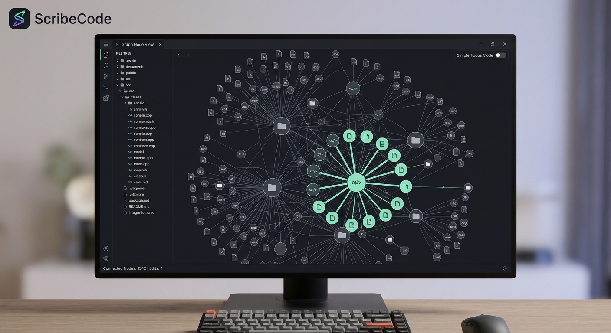
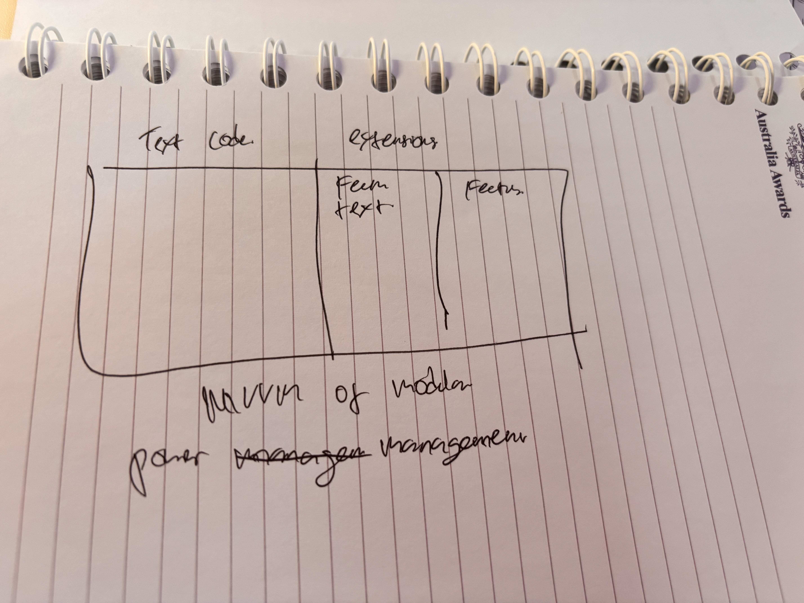

# Scrible

**Scrible** blends prose documentation with executable code — clean, professional, and distraction-free.

---

## Overview

Scrible is a hybrid editor that lets you write, document, and run code in a single workspace. It switches between a minimal writing view and a full developer suite with one click.

---

## Interface Modes

### Simple Mode (Zen / Writing View)
Distraction-free canvas with clean typography and a minimal status bar. Ideal for drafting, reading, and mobile edits. A single floating toggle sits in the top-right corner.

### Focus Mode (Full Developer Suite)
Expands into a complete IDE layout with side panels, file tree, integrated terminal, debug output, Git integration, VS Code extension management, and an AI assistant panel.

---

## Features

| Feature | Description |
|---|---|
| **Cross-Platform Engine** | Core written in C++ for fast boot times on Linux, Windows, macOS, Android, and iOS |
| **Hybrid Document Editor** | Mixes formatted prose (Markdown / WYSIWYG) with inline executable code blocks |
| **VS Code Extension Layer** | Supports Open VSX / VS Code extensions and language servers (LSP) |
| **Embedded Execution Engine** | Run code snippets directly in the document via local runtimes or remote SSH/containers |

---

## Feature Graph

*Visual map of Scrible's core feature relationships and capabilities.*

